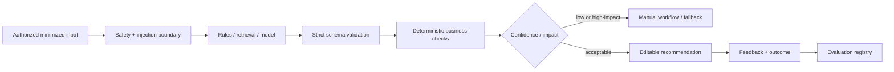

# AI System Architecture and Governance

AI features are versioned decision-support services. They return typed evidence and confidence, tolerate failure, and never directly mutate booking, verification, ledger, blacklist or payout state.

## 1. Shared pipeline



Each `ai_run` records module, subject, input hash, provider/model snapshot, prompt/schema version, latency, token/cost data, status and trace. Avoid storing raw restricted inputs when a hash/redacted snapshot is enough.

## 2. Module contracts

| Module | Inputs | Output | Fallback / guardrail |
|---|---|---|---|
| Smart intake | text, locale, authorized media features | service/category candidates, structured fields, missing questions | manual form/category browse |
| Predictive pricing | confirmed intake, region, historical outcomes, image features | p10/p50/p90 price, duration, difficulty, assumptions, confidence | category rules/provider quote |
| Matchmaking | confirmed job, eligible provider features | ranked provider IDs and reason codes | deterministic weighted rank |
| Recommendation | user/context + authorized catalog | diverse listing IDs | popular/local catalog |
| Semantic search | query embedding + lexical query | authorized candidate IDs | PostgreSQL full-text/trigram |
| Fraud detection | event/identity/device/payment aggregates | signals and risk band | rules/manual review; no auto-ban from LLM |
| Review moderation | review/media signals | labels, evidence, confidence | publish delay/manual moderation |
| Chat assistant/translation | selected conversation content | draft or translation | original content; user confirms send |
| Business insights | aggregated tenant metrics | narrative with cited metric IDs | standard dashboard |
| Demand/revenue forecast | privacy-safe time series | interval forecast, horizon, drivers | historical baseline |

## 3. Intake schema example

```json
{
  "schemaVersion": "intake.v1",
  "language": "id",
  "serviceCandidates": [{ "serviceId": "uuid", "confidence": 0.82 }],
  "summary": "Perbaikan kebocoran pipa di dapur",
  "attributes": { "urgency": "same_day", "propertyType": "house" },
  "missingQuestions": ["Apakah sumber air sudah dimatikan?"],
  "safetyFlags": ["water_damage"],
  "assumptions": ["Lokasi dapat diakses teknisi"],
  "overallConfidence": 0.74
}
```

Use strict JSON schema/Structured Outputs where supported, then Zod-parse and validate referenced IDs against the authorized catalog. The model never invents a service ID that bypasses lookup.

## 4. Matchmaking and ranking

### Candidate generation hard filters

- Provider/listing active and verified; service/category eligible.
- Job point inside service area/radius.
- Availability/capacity compatible; no suspension/blacklist/conflict.
- Booking mode and price/currency constraints compatible.
- Required business/compliance credential valid.

### Cold-start score

Normalize every feature to `[0,1]` and version weights by category:

```text
score = 0.25 skill_relevance
      + 0.16 availability_fit
      + 0.14 distance_fit
      + 0.12 quality_bayesian
      + 0.10 completion_rate
      + 0.08 response_speed
      + 0.08 price_fit
      + 0.07 trust_score
      - risk_penalty
```

Use Bayesian-shrunk ratings so one five-star job does not outrank a consistently good provider. Apply diversity/exploration after scoring to avoid permanent rich-get-richer effects. Never use protected traits or obvious proxies. Return reason codes such as `AVAILABLE_TODAY`, `NEARBY`, `STRONG_CATEGORY_HISTORY`; do not expose sensitive risk details.

Online learning begins only after sufficient, unbiased outcome data. Counter position bias through randomized exploration and logged propensities. Optimize completed, satisfactory jobs—not clicks alone.

## 5. Predictive pricing

The output is an interval, not a promise:

```json
{
  "currency": "IDR",
  "p10": 175000,
  "p50": 250000,
  "p90": 425000,
  "durationMinutes": { "low": 60, "high": 150 },
  "difficulty": "medium",
  "included": ["labor"],
  "excluded": ["replacement parts"],
  "assumptions": ["damage is locally accessible"],
  "confidence": 0.68,
  "modelVersion": "pricing-plumbing-id-jkt-1"
}
```

Start with category/region robust statistics plus rules, then add supervised quantile models when enough verified outcomes exist. LLM/image analysis produces structured features; it does not calculate the final amount without deterministic bounds. Measure p10–p90 coverage, interval width, median absolute percentage error and dispute correlation by category/region. Low confidence forces provider quote.

## 6. Fraud and identity

OCR/liveness is handled by a specialist vendor under explicit consent. Signals can include verified mismatch, velocity, device/account linkage, payout reuse, payment anomaly and behavioral inconsistency. Combine explainable rules and calibrated statistical models. An LLM may summarize a case but cannot be the sole risk scorer.

Actions are progressive: allow, step-up verification, limit transaction, queue review, temporarily hold risky payout, or suspend after authorized human decision. Users receive an appropriate reason and appeal path without revealing detection evasion details. Monitor false-positive and appeal-overturn rates across relevant cohorts.

## 7. Retrieval and semantic search

1. Normalize Bahasa Indonesia query and generate embedding server-side.
2. Apply tenant/public visibility, status, geography and service filters before exposing results.
3. Retrieve lexical and vector candidates from approved catalog only.
4. Fuse rankings (for example reciprocal-rank fusion), then apply business constraints.
5. Return entity IDs/snippets from stored records; generated text is clearly labeled.

Embedding metadata includes model, dimensions, source version, locale and embedded timestamp. Re-embedding runs through outbox jobs. Do not silently mix incompatible embedding spaces.

## 8. Evaluation and release

| Module | Offline metrics | Online guardrails |
|---|---|---|
| Intake | field F1, category top-k, confidence calibration | correction/abandon rate |
| Pricing | interval coverage/width, MAE/MAPE | disputes, quote override |
| Ranking | NDCG, recall of successful provider, calibration | completion, cancellations, exposure fairness |
| Fraud | precision/recall at action threshold, calibration | false positives, appeal overturn, loss |
| Moderation | per-label precision/recall | report rate and successful appeals |
| Translation | human adequacy/safety sample | correction/report rate |
| Forecast | WAPE and interval coverage | planning error |

Release gate: curated golden set, adversarial/prompt-injection set, Bahasa Indonesia/regional coverage, privacy test, latency/cost budget, shadow run, human review, small canary and rollback switch. Pin model snapshots because behavior can change between snapshots; [OpenAI recommends pinned versions and evals](https://platform.openai.com/docs/api-reference/backward-compatibility).

## 9. Operations

- Timeouts and one bounded retry for safe calls; circuit breaker and module-level kill switch.
- Async for media, forecasts and batch embeddings; synchronous only where latency is predictable.
- Cache only non-sensitive deterministic results with input/model/prompt/schema in the key.
- Budget by tenant/module and alert on token, cost, latency, schema-failure and fallback anomalies.
- Provider outage never blocks manual booking, paid job completion, dispute or payout reconciliation.
- Feedback distinguishes `accepted`, `edited`, `rejected` and actual outcome; user text is not automatically training consent.
