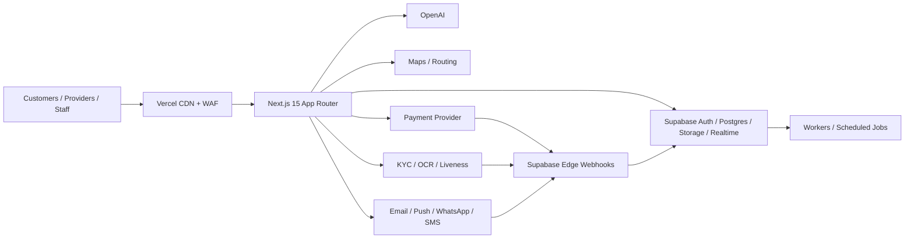

# Technical Architecture

## 1. Quality attributes

The design prioritizes financial correctness, tenant isolation, auditability, graceful degradation and delivery speed. Initial targets are 99.9% monthly availability, API p95 below 400 ms for ordinary reads/writes (excluding vendors and AI), realtime p95 below 1 s, RPO at most 15 minutes and RTO at most 2 hours. Verify targets under an agreed load profile.

## 2. System context



## 3. Deployment units

| Unit | Responsibility | Trust level |
|---|---|---|
| Next.js web | Server Components, UI, Route Handler BFF, authenticated commands | Public edge/server |
| Supabase Auth | Email, Google, phone OTP, sessions, staff MFA | Identity boundary |
| PostgreSQL | Transactions, RLS, ledger, outbox, audit, PostGIS, pgvector | Source of truth |
| Storage | Private KYC/job/chat media; approved public portfolio media | Policy protected |
| Realtime | Private chat, job, location and notification channels | Authenticated |
| Edge Functions | Signed vendor webhooks and lightweight integrations | Privileged server |
| Worker | Outbox, PDFs, embeddings, notifications and reconciliation | Privileged server |

Long or unbounded work never runs in request handlers. A Route Handler creates a durable task/outbox record and returns `202`; a worker leases and executes it.

## 4. Domain modules

The launch architecture is a modular monolith. Modules may use shared value types but cannot write another module’s tables directly.

| Module | Owns |
|---|---|
| Identity | profiles, addresses, roles, consent |
| Organizations | businesses, memberships, KYB |
| Provider | providers, skills, availability, service areas, portfolios |
| Catalog | categories, services, pricing rules |
| Discovery | search documents, embeddings, ranking snapshots |
| Jobs | requests, matches, bookings, transitions, tracking |
| Conversation | conversations, participants, messages, attachments |
| Trust | KYC, fraud signals/cases, blacklist, moderation |
| Payments | PSP-neutral intents/events, ledger, holds, refunds and payouts; Xendit first, Midtrans adapter optional |
| Disputes | cases, evidence, decisions |
| Billing | invoices, lines, tax snapshots |
| Reputation | reviews, responses, moderation |
| Notifications | preferences, templates, deliveries |
| Operations | audit, outbox, idempotency, flags, settings |
| Intelligence | AI runs, predictions, feedback, model versions |

## 5. Request paths

### Query

1. Browser calls a Server Component or `/api/v1` Route Handler with its Supabase session.
2. The server creates a user-scoped client, so RLS applies.
3. Public catalog reads use explicit cache tags. Personal, location, financial and admin responses are `private, no-store`.
4. TanStack Query hydrates only interactive, paginated or realtime client views.

### Command

1. Parse with Zod and reject unknown keys on sensitive payloads.
2. Authenticate, check coarse permission and claim `Idempotency-Key`.
3. Execute one database transaction through a narrowly granted RPC/command service.
4. Lock stateful or financial rows, validate transition and optimistic `version`.
5. Write business data, audit record and outbox event atomically.
6. Return a stable envelope with correlation ID and resource version.

### Webhook

1. Preserve raw body; verify signature, timestamp, source and secret.
2. Insert provider/event ID into a unique inbox before processing.
3. Acknowledge quickly; process idempotently in a worker.
4. Fetch provider state server-to-server where supported; never trust a browser redirect.
5. Reconcile amount, currency, account and expected state before ledger posting.

## 6. Critical workflows

```mermaid
sequenceDiagram
  participant C as Customer
  participant API as Command API
  participant DB as PostgreSQL
  participant PSP as Payment Provider
  participant W as Worker
  C->>API: Create booking (Idempotency-Key)
  API->>DB: lock quote; booking + intent + outbox
  API-->>C: pending_payment + checkout action
  W->>PSP: create payment request
  PSP-->>API: signed payment webhook
  API->>DB: inbox dedupe; ledger post; activate booking
  DB-->>W: notification outbox
  W-->>C: payment confirmed
```

The held amount is represented by balanced ledger entries and a `payment_hold`. Release requires completion evidence, the confirmation/timeout rule, no open dispute, a verified payout account and a risk check. Refund, fee and payout are separate postings.

### Job state machine

```text
draft -> requested -> matched -> awaiting_payment -> confirmed -> accepted
accepted -> en_route -> in_progress -> provider_completed -> customer_confirmed -> closed
requested|matched|awaiting_payment|confirmed|accepted -> cancelled
in_progress|provider_completed|customer_confirmed -> disputed
disputed -> resolved -> closed|cancelled
```

Every transition is appended to `job_status_events`, checked against an allowed-transition map and protected by row lock plus version. Tracking ends at terminal state.

## 7. Realtime and location

- Private channels: `conversation:{id}`, `job:{id}`, `user:{id}`; membership is policy checked.
- Persist chat before broadcast. Broadcast accelerates delivery but is not the source of truth.
- Throttle provider location to roughly 5–15 seconds while en route. Keep detailed trails briefly and a coarse last location longer.
- Exact coordinates are limited to active job participants and authorized support. Discovery uses coarse distance.

## 8. Data and consistency

- UUID keys; `timestamptz`; IDR values as integer rupiah (`bigint`), never float.
- PostGIS `geography(Point,4326)` for distance and pgvector for semantic retrieval.
- Transactional outbox gives at-least-once delivery; consumers are idempotent.
- Financial and audit records are append-only. Corrections are reversals.
- Search/read projections are disposable; PostgreSQL remains authoritative.

## 9. Degradation

| Dependency failure | Behavior |
|---|---|
| OpenAI | Rules/filters and manual selection; paid work continues |
| Maps | Last known location/status and manual updates |
| KYC vendor | `pending_vendor`; provider cannot activate |
| Notifications | Retry allowed alternate channel; retain in-app record |
| PSP | Stop new checkout/release; preserve ledger; reconcile after recovery |
| Realtime | Poll canonical endpoints with backoff |

Use strict timeouts, circuit breakers, retry budgets and workload bulkheads.

## 10. Decisions and official references

| Decision | Choice |
|---|---|
| ADR-001 | Supabase Auth only |
| ADR-002 | SQL migrations; no dual ORM schema authority |
| ADR-003 | Next.js BFF plus Edge webhook functions |
| ADR-004 | Modular monolith first |
| ADR-005 | Double-entry ledger |
| ADR-006 | Hard filters + interpretable ranker + optional learned reranker |
| ADR-007 | Human review for high-impact AI |

- [Next.js 15 Route Handlers](https://nextjs.org/docs/15/app/getting-started/route-handlers-and-middleware) define the BFF convention.
- [Supabase RLS](https://supabase.com/docs/guides/database/postgres/row-level-security) is the database authorization boundary; use non-user-editable app metadata for claims.
- [Supabase Edge Functions](https://supabase.com/docs/guides/functions) should be short-lived and idempotent; heavy work belongs in workers.
- [Xendit XenPlatform](https://docs.xendit.co/docs/xenplatform-overview) supports marketplace accounts/splits, but legal escrow status still needs independent approval.

Integrations implement a PSP port (`createPayment`, `verifyWebhook`, `refund`, `payout`, `reconcile`). Select one production system of record for launch—recommended evaluation: Xendit marketplace/subaccount capabilities versus Midtrans payment channels—and do not route the same booking through both. A second adapter is failover/migration capability only after separate certification and reconciliation design.
