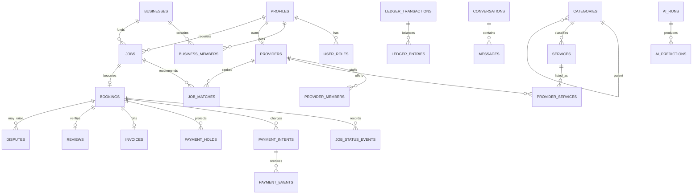

# Database Architecture

The executable baseline is [0001_initial_schema.sql](supabase/migrations/0001_initial_schema.sql), [0002_finance_trust_operations.sql](supabase/migrations/0002_finance_trust_operations.sql), then [0003_rls.sql](supabase/migrations/0003_rls.sql). SQL migrations are authoritative; generate TypeScript types after migration.

## 1. Modeling rules

- `auth.users` owns credentials. `profiles` owns application identity; never duplicate passwords.
- A user has many `user_roles`, business memberships and provider memberships.
- Money is integer minor units (`bigint`, IDR rupiah), with ISO currency. Never use floats.
- Store instants as `timestamptz` in UTC; render in the user/tenant time zone.
- Business tables use UUID keys, explicit foreign keys, checks and lifecycle status.
- Mutable resources carry `version` for optimistic concurrency.
- Financial, status, provider webhook and audit histories are append-only.
- PII/KYC files are private Storage objects referenced by `files`; buckets and object paths have separate policies.
- JSONB is limited to vendor payloads, snapshots and extensible evidence. Queryable domain data stays relational.

## 2. Bounded schemas

The baseline uses `public` for exposed product data and `private` for helpers/internal data. At scale, modules may move into dedicated schemas, but clients must only access reviewed views/RPCs.

| Area | Main tables |
|---|---|
| Identity/tenant | profiles, user_roles, addresses, businesses, business_members, business_cost_centers, business_approval_rules, approval_requests |
| Provider/catalog | providers, provider_members, categories, services, provider_services, provider_availability, provider_service_areas, provider_portfolios |
| Work | jobs, job_matches, bookings, job_status_events, tracking_points |
| Conversation | conversations, conversation_participants, messages, message_receipts |
| Trust | verification_cases, compliance_documents, fraud_signals, fraud_cases, blacklist_entries |
| Money | payment_intents, payment_events, ledger_accounts, ledger_transactions, ledger_entries, payment_holds, refunds, payouts |
| Case/billing | disputes, dispute_evidence, invoices, invoice_lines, reviews |
| Platform | files, notifications, contracts, support_tickets, pricing_rules, commission_rules, cms_pages, banners, ai_runs, ai_predictions, audit_logs, activity_logs, outbox_events, idempotency_keys, system_settings |

## 3. ERD

## 4. Critical invariants

### Booking

- Exactly one active booking per accepted job; capacity is checked inside a transaction.
- The booking stores quote, fee, tax, cancellation and auto-confirm snapshots.
- Status changes only through a command/RPC that locks the booking and inserts a status event.
- A review requires a closed/customer-confirmed booking and is unique by booking/customer.

### Ledger

- Each `ledger_transaction` has at least two entries; signed entry sum per currency is zero.
- Posted entries are immutable. Reversal references the original transaction.
- Provider balance is derived from entries, never updated as an unaudited counter.
- Payment provider event IDs are unique. Amount/currency mismatches become reconciliation exceptions.
- Release cannot exceed captured hold less prior release/refund.

The migration provides relational structure. Implement deferred balanced-transaction enforcement in a reviewed SQL function used by the payment command path, and test that direct mutation is denied.

### Tenancy and privacy

- Business data is authorized through active membership plus scoped business role.
- Provider data is authorized through active provider membership.
- Chat requires conversation participation; job chat participants are derived from booking parties.
- Exact tracking requires active booking participation and is retained briefly.
- Staff access requires explicit `user_roles`, recent MFA for sensitive actions, a reason, and audit entry.

## 5. Index strategy

- B-tree every foreign key used by RLS and every common status/time filter.
- Partial indexes for open jobs, active listings, undelivered outbox and unresolved cases.
- GiST for service-area/location geography; HNSW/IVFFlat vector index only after data volume/query evidence.
- Trigram or full-text GIN for Indonesian catalog search; vector search is a reranking candidate source, not the only search path.
- Cursor pagination uses stable `(created_at, id)` or domain-specific sort keys; no deep `OFFSET`.

Review index usage with `pg_stat_statements`; unused indexes add write cost and must be removed through migrations.

## 6. RLS matrix

| Resource | Guest | User | Business/provider member | Staff |
|---|---|---|---|---|
| Approved catalog/profile | read safe fields | read | manage owned scope | scoped manage |
| Job/booking | none | own participant | tenant/provider scope | scoped support read |
| Chat/tracking | none | participant | participant | case-bound read |
| KYC documents | none | own status/limited metadata | compliance submitter | compliance only |
| Ledger/payment | none | own booking summary | own payout summary | finance only |
| Audit/system settings | none | none | none | explicitly scoped |

RLS is defense in depth. Route handlers also check permissions for clear errors and business invariants. Service-role credentials are server-only and never used for ordinary user operations.

## 7. Retention baseline

Final periods require legal approval. Starting proposals:

| Data | Proposed rule |
|---|---|
| Exact tracking trail | delete/anonymize 30 days after terminal job unless legal hold |
| Chat attachments | 2 years after job, shorter if no transaction, subject to dispute hold |
| KYC raw media | vendor/legal minimum; encrypt, tightly restrict and delete on schedule |
| AI request content | minimize/redact; 90 days operational unless consent/legal basis allows more |
| Invoices/ledger/audit | statutory/contractual period approved by finance/legal |
| Account deletion | de-identify eligible product data; preserve required financial/legal records |

Retention jobs write audit results and metrics. Legal holds suspend deletion for named records only.

## 8. Migration and backup discipline

Use expand/migrate/contract for zero-downtime changes. CI starts a clean local Supabase instance, applies all migrations, runs pgTAP/RLS tests and compares generated types. Production migrations are forward-only with a restore/forward-fix plan. Backups are not considered valid until a restore is tested; see [OPERATIONS.md](OPERATIONS.md).
