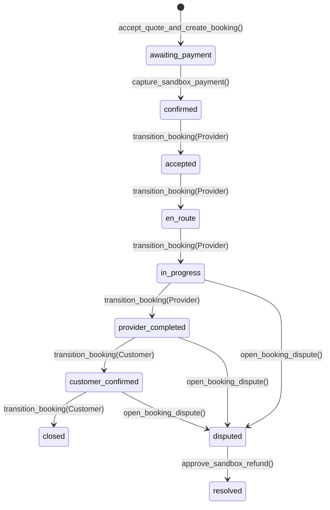

# 05 — Order State Machine

**Audit date:** 2026-07-18  
**Auditor:** Automated + Manual  
**Status:** PASS

---

## 1. Job and Booking Status Definitions

The transaction workflow is split across two main entities: `jobs` (the demand request) and `bookings` (the scheduled fulfillment transaction). Their statuses sync at key milestones.

### Job Statuses
- `draft`: Created by customer, not yet published.
- `requested`: Published and awaiting provider matching.
- `matched`: Provider matches found and invitations sent.
- `awaiting_payment`: Customer selected a provider quote; booking created.
- `confirmed`: Sandbox payment successfully captured.
- `accepted` / `en_route` / `in_progress` / `provider_completed`: Synchronized with active booking status.
- `customer_confirmed` / `closed` / `disputed` / `resolved` / `cancelled`: Synchronized terminal or exception states.

### Booking Statuses
- `awaiting_payment`: Initial booking state after quote acceptance.
- `confirmed`: Payment captured, work is scheduled.
- `accepted`: Provider acknowledged scheduled task.
- `en_route`: Provider traveling to customer location.
- `in_progress`: Work actively being executed.
- `provider_completed`: Provider marked job as finished.
- `customer_confirmed`: Customer confirmed and approved the work.
- `closed`: Job archived and payment hold fully resolved.
- `disputed`: Customer froze payment release due to a conflict.
- `resolved`: Dispute resolved by support staff.
- `cancelled`: Terminated prior to start or during processing.

---

## 2. Transition Map & Actor Rules

Mutations of booking and job states are guarded by the `transition_booking(p_booking_id, p_to_status, p_note, p_idempotency_key)` function. Transitions must be sequential and are strictly role-segregated:



### Transition Guards
1. **Provider Actions (Strictly verified via `private.is_provider_member`):**
   - `confirmed` ➔ `accepted`: Provider accepts job.
   - `accepted` ➔ `en_route`: Provider departs for location.
   - `en_route` ➔ `in_progress`: Provider begins work.
   - `in_progress` ➔ `provider_completed`: Provider completes work.

2. **Customer Actions (Strictly verified via direct `customer_id` check):**
   - `provider_completed` ➔ `customer_confirmed`: Customer confirms completion.
   - `customer_confirmed` ➔ `closed`: Customer closes the booking.

3. **Validation Rule Logic:**
   The database enforces state sequencing. If an actor attempts to skip a state (e.g., transitioning from `accepted` directly to `in_progress`), the trigger throws an exception:
   `invalid booking transition (SQLSTATE 22023)`

---

## 3. Idempotency and State Safety

State changes rely on an idempotency registry table (`idempotency_keys`) to prevent double-submits from unstable mobile connections or web browser retries:
```sql
if exists(select 1 from public.idempotency_keys where principal_id=actor_id and scope='booking.transition' and key=p_idempotency_key) then 
  return b.id; 
end if;
```
If a request is retried with the same idempotency key, the function returns the existing booking ID without executing the transition logic again or throwing a state collision error.

---

## 4. State Integration in the Next.js Codebase

Client-side transitions are driven by helper definitions inside:
`src/lib/booking-workflow.ts`
Which maps:
```typescript
const providerActions: Record<string, BookingAction> = {
  confirmed: { status: "accepted", label: "Terima pekerjaan" },
  accepted: { status: "en_route", label: "Berangkat ke lokasi" },
  en_route: { status: "in_progress", label: "Mulai pekerjaan" },
  in_progress: { status: "provider_completed", label: "Tandai selesai" },
}
```
And matches them with UI controls in `src/components/transaction/booking-actions.tsx`. When clicked, it triggers the secure database RPC. This ensures client components only expose valid transitions that match database-enforced state validation rules.
