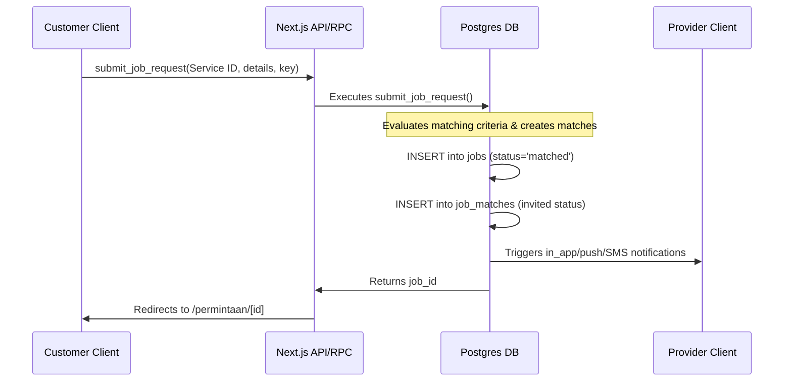

# 06 — AI Smart Matchmaking

**Audit date:** 2026-07-18  
**Auditor:** Automated + Manual  
**Status:** PASS (Deterministic Baseline)

---

## 1. System Implementation Summary

Matchmaking operates via two pathways:
1. **Asynchronous/Batch Matchmaking (Database Layer):** Executed when submitting standard or emergency jobs via SQL RPCs, auto-populating matching provider invitations directly into the `job_matches` table.
2. **Dynamic/Interactive Search (Application Layer):** Executed in Next.js when searching or sorting provider directories (`src/lib/ai/ranking.ts`).

Both layers use deterministic algorithms that evaluate providers based on service catalog alignment, geography, performance metrics, and responsiveness.

---

## 2. Matchmaking Algorithms & Math Models

### 1. Database Matchmaking Models
Matchmaking formulas vary depending on the urgency of the request to prioritize speed during emergencies:

#### Standard Job Matchmaking (`submit_job_request`)
Standard matchmaking prioritizes service quality (rating) over speed of response:
$$\text{Score} = \min\left(1, \frac{\text{rating\_avg}}{5} \times 0.6 + \frac{\text{response\_rate}}{100} \times 0.4\right)$$
- **Target Count:** Top 10 matching providers invited.
- **Sorting Priorities:** Order by rating descending, response rate descending.

#### Emergency Dispatch Matchmaking (`submit_emergency_job_request`)
Emergency matchmaking shifts the weight to prioritize speed of response:
$$\text{Score} = \min\left(1, \frac{\text{response\_rate}}{100} \times 0.55 + \frac{\text{rating\_avg}}{5} \times 0.45\right)$$
- **Target Count:** Top 5 matching providers invited.
- **Sorting Priorities:** Order by response rate descending, rating descending.
- **Prerequisite:** The target catalog service must have `emergency_enabled = true`.

### 2. Client-Side Matchmaking (`rankProviders`)
The application ranking system evaluates provider compatibility out of a maximum score of 100 points:

| Component | Calculation | Max Points |
|---|---|---|
| **Rating Score** | $\min\left(\frac{\text{rating}}{5}, 1\right) \times 25$ | 25 points |
| **Response Rate** | $\min\left(\frac{\text{response\_rate}}{100}, 1\right) \times 20$ | 20 points |
| **Experience Scale** | $\min\left(\frac{\log_{10}(\text{completed\_jobs} + 1)}{3}, 1\right) \times 15$ | 15 points |
| **Text Relevance** | $+30$ points if search keyword matches service name/category | 30 points |
| **Geographic Match** | $+10$ points if requested area matches provider's coverage | 10 points |

#### Logarithmic Experience Scaling
 completed jobs are scaled using $\log_{10}(\text{completed\_jobs} + 1)$ to prevent established providers with thousands of jobs from permanently crowding out new entrants. The score scale reaches maximum return at 1,000 completed jobs:
- 0 completed jobs = 0 points
- 9 completed jobs = 5 points
- 99 completed jobs = 10 points
- 999+ completed jobs = 15 points

---

## 3. Data Flow & Security Auditing



### Security Isolation Controls
- Matchmaking executes inside `SECURITY DEFINER` database operations. The client only initiates requests and cannot manipulate scores, insert matches, or invite arbitrary providers.
- Providers can only view details of jobs for which they have a record in `job_matches`:
  ```sql
  create policy jobs_matched_provider_read on public.jobs for select to authenticated using (
    id in (select job_id from public.job_matches m where private.is_provider_member(m.provider_id, null))
  );
  ```
  This restricts job details to invited providers only, preventing scraping of customer directories.
- Geographic calculations in SQL utilize PostGIS index checks (`public.st_setsrid()`), ensuring lookups perform in logarithmic time.
