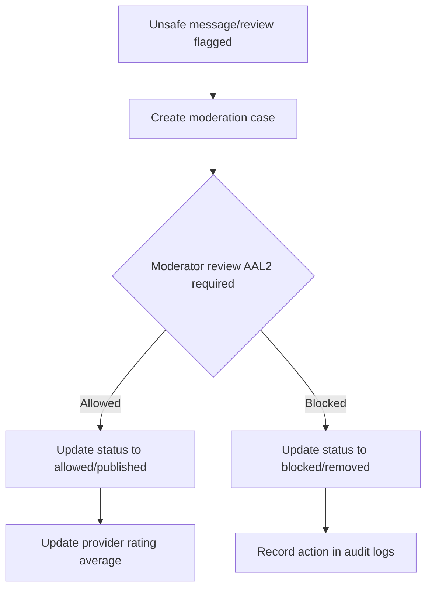

# 08 — AI Fraud & Safety Verification

**Audit date:** 2026-07-18  
**Auditor:** Automated + Manual  
**Status:** PASS

---

## 1. Real-Time Chat & Review Moderation

The safety verification system implements active content filtering to identify threat vectors, scam patterns, and sensitive data exposure at the database boundary before rows are committed.

### Moderation Pattern Engine (`send_moderated_message` & `submit_verified_review`)
Message text and review descriptions are evaluated against Indonesian-specific threat patterns:
$$\text{unsafe} = \text{RegexpMatch}(\text{body}, \text{'(ancam|bunuh|penipuan|nomor kartu|kata sandi)'})$$

#### Flagged Message Path
If flagged as unsafe:
1. The message body is redacted with: `'[Pesan ditahan untuk pemeriksaan moderasi]'`.
2. The `moderation_status` is set to `'flagged'`.
3. A pending record is inserted into `moderation_cases` with confidence `0.88` and label `'safety_or_sensitive_data'`.
4. The message is withheld from participants until cleared by a moderator.

#### Flagged Review Path
If flagged as unsafe:
1. The review status is set to `'flagged'`.
2. A pending record is inserted into `moderation_cases` with confidence `0.88`.
3. Provider rating aggregations (`rating_avg`, `rating_count`) are frozen and do not incorporate the review score until it is approved.

---

## 2. Moderation Case Resolution Workflow

Moderation queue reviews are managed via `resolve_moderation_case` under strict administrative guidelines:

### Resolution Rules
- **Authentication Level:** Requires `aal2` verification.
- **Roles Permitted:** `'support'`, `'compliance'`, `'admin'`, or `'super_admin'`.
- **Outcome Mapping:**
  - If approved (`'allowed'`):
    - Messages: Status updated to `'allowed'`, revealing the text.
    - Reviews: Status updated to `'published'`. Rating averages and review counts are updated dynamically.
  - If rejected (`'blocked'`):
    - Messages: Status remains `'blocked'`.
    - Reviews: Status updated to `'removed'`.
- **Audit Requirement:** The moderator must supply a decision reason of at least 10 characters, which is written to the immutable `audit_logs` table.

---

## 3. Fraud Signals & Risk Scoring Model

The fraud engine uses an additive risk score model to evaluate accounts:

### Risk Calculation Model
When a compliance worker executes `open_fraud_case(p_user_id, p_booking_id, p_reason, p_correlation_id)`:
1. It aggregates all active, unexpired fraud signals for the target user:
   $$\text{Risk Score} = \min\left(100, \sum (\text{score} \times 100)\right)$$
2. If the aggregated risk score is `0`, the request is rejected.
3. If greater than zero, a new fraud case is created and assigned a severity level based on the risk threshold:
   - **Critical:** Risk Score $\ge 80$
   - **High:** Risk Score $\ge 60$
   - **Medium:** Risk Score $\ge 30$
   - **Low:** Risk Score $< 30$

### Resolution Mapping
Compliance staff decides the fraud case outcome using `decide_fraud_case(p_case_id, p_decision, p_reason)`:
- `'cleared'`: Status updated, allowing normal account operations.
- `'confirmed'`: The fraud case is confirmed. This record serves as the database evidence for subsequent user suspensions or entries in `blacklist_entries` (e.g. banning user/phone/email hashes).
- **Security Check:** Requires AAL2 authentication and independent review validation (the moderator opening the case cannot resolve it).
