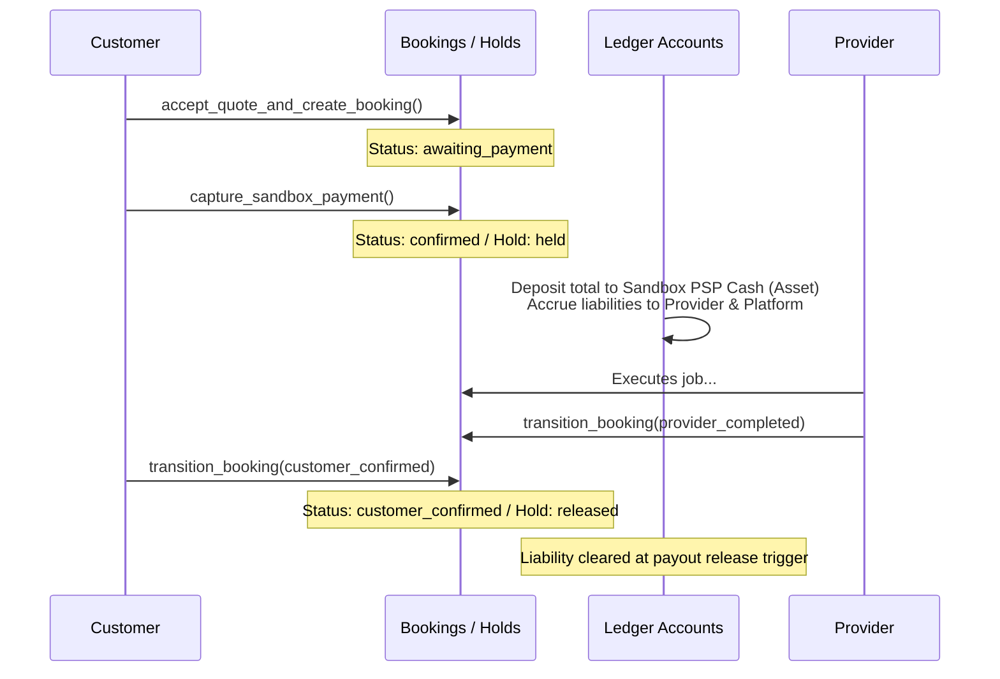

# 09 — Payments, Escrow & Financial Audit

**Audit date:** 2026-07-18  
**Auditor:** Automated + Manual  
**Status:** PASS (Fail-Closed Sandbox Baseline)

---

## 1. Escrow & Delayed Payment Release Lifecycle

The payment workflow uses an escrow model that holds funds in the platform's assets until the customer confirms successful service delivery.

### Escrow Mechanics
1. **Holding Funds:** When a customer pays (`capture_sandbox_payment`), the booking transitions to `'confirmed'`. A hold record is created in `payment_holds` with status `'held'`.
2. **Release Trigger:** When the booking transitions to `'customer_confirmed'`, the database automatically updates the hold status to `'released'`, authorizing the payout engine to schedule disbursement.
3. **Freezing Funds:** If a dispute is opened prior to customer confirmation, the hold status transitions to `'frozen'`, blocking automatic payout releases until resolved by support staff.

---

## 2. Double-Entry General Ledger Design

All monetary transactions are tracked using a double-entry general ledger schema that records assets, liabilities, and revenues, ensuring full mathematical balance.

### Account Matrix
- **Asset Account:** `Sandbox PSP cash` (Represents cash held in payment processor).
- **Liability Account (Provider):** `Provider payable` (Represents funds due to the provider).
- **Revenue Account:** `Platform fee` (Represents the 10% platform platform cut).
- **Liability Account (Tax):** `Tax payable` (Represents taxes due to government entities).

### Balanced Transaction Check
For every debit, there must be a matching credit. For a booking payment, the ledger postings are:
$$\text{Entry}_{\text{PSP Cash}} = +\text{total\_amount}$$
$$\text{Entry}_{\text{Provider Payable}} = -\text{subtotal}$$
$$\text{Entry}_{\text{Platform Fee}} = -\text{platform\_fee}$$
$$\text{Entry}_{\text{Tax Payable}} = -\text{tax\_amount}$$
Summing these yields exactly zero:
$$+\text{total\_amount} - (\text{subtotal} + \text{platform\_fee} + \text{tax\_amount}) = 0$$

---

## 3. Refund & Dispute Settlement Auditing

Refunds are triggered by dispute settlements and require independent administrative verification:

### Refund Mechanics
1. A support operator recommends a refund amount via `recommend_dispute_resolution`.
2. A finance auditor approves the refund via `approve_sandbox_refund`, which executes the ledger reversal:
   - **PSP Cash:** Debited by $-\text{refund\_amount}$ (funds returned to customer).
   - **Provider Payable:** Credited by $+\text{provider\_part}$ (liability to provider reduced).
   - **Platform Fee:** Credited by $+\text{fee\_part}$ (platform fee waived/reduced).
3. The booking, job, and dispute statuses are updated to `'resolved'`.

### Security Constraints
- **Production Guard:** Sandbox payment/refund functions block execution if the app environment is `'production'`.
- **MFA Enforcement:** Approvals require `aal2` (MFA verified session) and the `'finance'` role.
- **Audit Logging:** Every step is written to the immutable audit log.
- **Segregation of Duties:** The operator recommending the refund (`requested_by`) cannot be the auditor approving it (`approved_by`).
