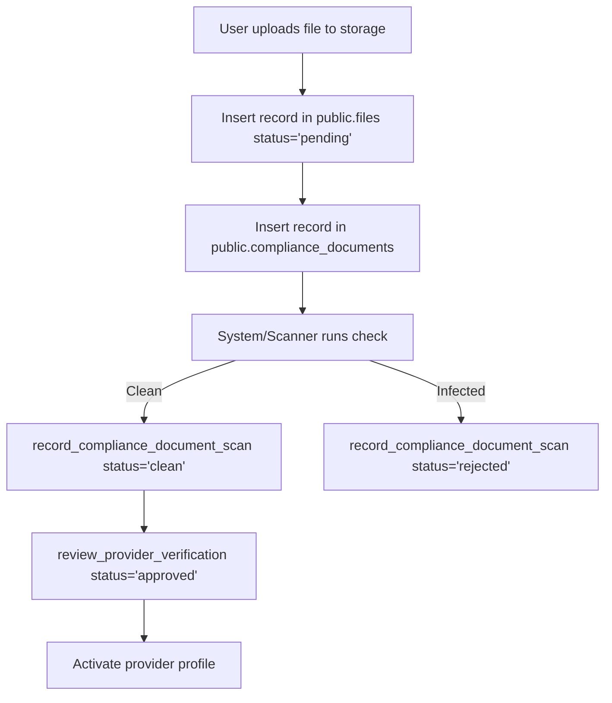

# 12 — File Storage & Document Scans

**Audit date:** 2026-07-18  
**Auditor:** Automated + Manual  
**Status:** PASS

---

## 1. Storage Bucket & Policy Configuration

Lumina Jasa uses Supabase Storage for secure, private document management. It handles business registrations and provider KYC documents via a designated bucket.

### Bucket Parameters (`compliance-documents`)
- **Public Visibility:** `false` (Private storage, objects are not accessible via public URL).
- **File Size Limit:** 8 MB (8,388,608 bytes).
- **MIME Types Allowed:** `application/pdf`, `image/jpeg`, `image/png`.

### Storage Row Level Security
Storage object permissions are restricted using the following policies:

#### 1. Insert Policy (`compliance_objects_owner_insert`)
Allows authenticated users to upload documents under their own folder prefix:
```sql
bucket_id = 'compliance-documents' and (storage.foldername(name))[1] = (select auth.uid())::text
```
This isolates uploads, preventing users from writing to other folders.

#### 2. Select Policy (`compliance_objects_owner_read`)
Restricts read access to the uploader or designated staff members:
```sql
bucket_id = 'compliance-documents' and (
  (storage.foldername(name))[1] = (select auth.uid())::text
  or private.has_platform_role('admin') 
  or private.has_platform_role('compliance') 
  or private.has_platform_role('super_admin')
)
```

#### 3. Delete Policy (`compliance_objects_owner_delete`)
Allows users to delete only their own uploaded documents:
```sql
bucket_id = 'compliance-documents' and (storage.foldername(name))[1] = (select auth.uid())::text
```

---

## 2. Compliance Document Scans

Uploaded documents are registered in the `files` and `compliance_documents` tables. They must pass a document scan check before the provider's profile can be approved.



### Verification Flow
1. **Initial State:** Files are uploaded with scan status set to `'pending'`.
2. **Scanner Execution:** A scanner verifies the upload and records the result using `record_compliance_document_scan(compliance_file_id, scan_result, scan_reason)`.
   - If infected: The document is rejected.
   - If clean: The status is updated to `'clean'`.
3. **Approval Guard:** The provider approval function (`review_provider_verification`) requires a clean scan:
   ```sql
   if decision = 'approved' and not exists (
     select 1 from public.compliance_documents d join public.files f on f.id = d.file_id
     where d.verification_case_id = $1 and f.scan_status = 'clean'
   ) then 
     raise exception 'clean document scan required' using errcode = '42501'; 
   end if;
   ```
   This prevents staff from bypassing security controls and approving unverified or malicious files.
- **Auditing:** Decisions require an AAL2 (MFA-verified) session and a compliance role, and are recorded in the platform audit logs.
