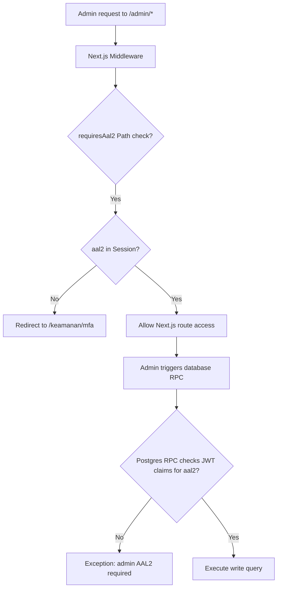

# 13 — Admin Dashboard & Operations

**Audit date:** 2026-07-18  
**Auditor:** Automated + Manual  
**Status:** PASS

---

## 1. Operational Dashboards

The administrative features are organized into modular, task-specific interfaces within the Next.js routing hierarchy under the `/admin` path:

- `/admin/verifikasi`: Displays the verification queue (`VerificationQueue.tsx`) for review of provider KYC/KYB documents.
- `/admin/kepercayaan`: Displays disputes and refund queues (`trust-queue.tsx`) to process payment hold exceptions.
- `/admin/moderasi`: Displays messages and reviews flagged by automated safety filters (`moderation-queue.tsx`).
- `/admin/peluncuran`: Exposes platform-wide feature flags and operational metrics (`launch-controls.tsx`).
- `/admin/skala`: Manages manual fraud signals, demand forecast model parameters, and provider ranking variables (`scale-operations.tsx`).

---

## 2. AAL2 & MFA Authentication Policy

To protect operational features from credential theft, the platform enforces Multi-Factor Authentication (MFA) AAL2 checks at both the application and database layers:



### 1. Application-Layer Enforcement (`src/lib/auth/aal.ts` & `middleware.ts`)
The application defines sensitive route prefixes:
```typescript
export const AAL2_PATH_PREFIXES = ["/admin", "/operasional", "/keuangan"] as const;
```
If a user attempts to access any route matching these prefixes, the middleware checks if they have successfully verified their second-factor auth:
```typescript
const isAal2 = hasAal2(session.user.app_metadata.aal);
if (!isAal2) {
  return NextResponse.redirect(new URL(`/keamanan/mfa?next=${pathname}`, request.url));
}
```
If not verified, they are redirected to `/keamanan/mfa` to enroll or complete their MFA challenge.

### 2. Database-Layer Enforcement (RPC Claims Checks)
To defend against client-side authentication bypass, write-heavy database functions perform their own checks:
```sql
if coalesce((select auth.jwt() ->> 'aal'), '') <> 'aal2' then
  raise exception 'admin AAL2 required' using errcode = '42501';
end if;
```
If the session token does not contain the `aal2` claim, the transaction is aborted and rolled back.

---

## 3. Platform Kill Switches & Feature Flags

Feature flags are configured in the `platform_feature_flags` table and act as instant kill switches for platform operations:
- `booking_intake`: Toggles new job postings.
- `payment_capture`: Toggles sandbox transaction captures.
- `payout_release`: Toggles payout releases.
- `ai_intake`: Toggles the AI smart matching engine.
- `tracking_publish`: Toggles provider location sharing.

### Immutability & Auditing
- Feature flags can only be modified via the `set_platform_feature_flag` RPC, which requires the `'admin'` or `'super_admin'` role and an active AAL2 session.
- Changes immediately write to `audit_logs`, tracking the actor ID, correlation ID, the target flag, and the transition states (`before_hash` ➔ `after_hash`).
- Trigger guards prevent actions on feature flags when they are disabled, throwing a `55000` exception to block the transaction.
