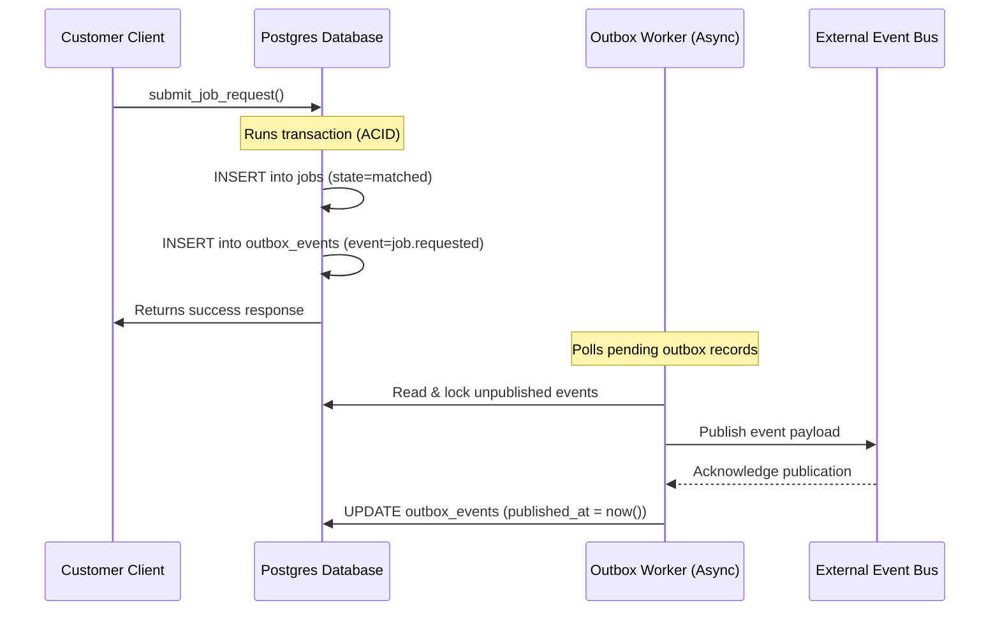

# 14 — Notifications & Outbox Pattern

**Audit date:** 2026-07-18  
**Auditor:** Automated + Manual  
**Status:** PASS

---

## 1. Outbox Pattern for Async Reliability

To ensure database consistency and prevent message loss, Lumina Jasa uses the **Transactional Outbox Pattern** for asynchronous system integrations.



### Outbox Mechanics
1. **Atomic Transactions:** When a write operation occurs (e.g., creating a job or booking), event records are written to `outbox_events` within the same database transaction. If the transaction fails, the outbox record is rolled back, preventing orphaned messages.
2. **Event Structure:** Records capture metadata including `aggregate_type`, `aggregate_id`, `event_type`, a JSONB `payload`, and a `correlation_id` for tracking.
3. **Execution Indexing:** Performance is optimized using a partial index on pending events:
   ```sql
   create index outbox_pending_idx on public.outbox_events(available_at) where published_at is null;
   ```
4. **Platform Monitoring:** Backlog metrics are exposed to administrators via `get_launch_metrics()` to monitor queue health:
   ```sql
   'outboxBacklog', (select count(*) from public.outbox_events where published_at is null and available_at <= now())
   ```

---

## 2. Notification Dispatch & Channels

User alerts are managed via the `notifications` and `notification_preferences` tables:

### Supported Channels
- `'in_app'`: Platform inbox messages (default fallback).
- `'email'`, `'push'`, `'whatsapp'`, `'sms'`: External delivery channels.

### Preference Verification
Before sending a non-system notification, the system verifies the user's opt-in choices:
```sql
select np.channel 
from public.notification_preferences np 
where np.user_id = p_user_id 
  and np.event_type = 'emergency.job_invited' 
  and np.enabled;
```
If disabled, the message is filtered out at source, saving bandwidth and respecting user preferences.

### Queue Status Tracking
Notifications are queued with initial status set to `'queued'`. A background worker handles transmission, updating the status to `'sending'` ➔ `'sent'`, or `'failed'` with an incremented `attempt_count` if it encounters delivery issues.
