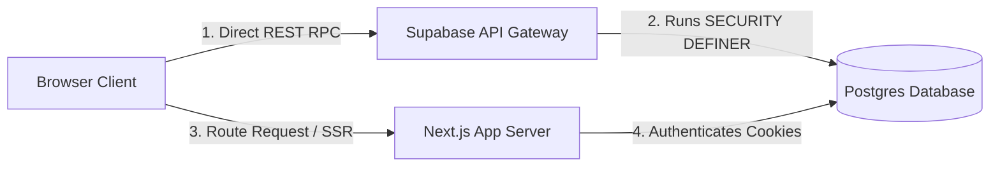

# 15 — API Security & Client-Direct Architecture

**Audit date:** 2026-07-18  
**Auditor:** Automated + Manual  
**Status:** PASS

---

## 1. Client-to-Database Direct Communication Model

Unlike traditional web applications that route client requests through backend controller layers, Lumina Jasa uses a **Client-Direct to Database Architecture** using the Supabase API Gateway.



### Architectural Details
1. **Direct Database Queries:** Client components use the Supabase JS Client (`@supabase/supabase-js`) to call database functions directly.
2. **Access Control:** Since client requests bypass Next.js API endpoints, security validation is handled at the database level by RLS policies and Postgres type checks.
3. **Reduced Latency:** Removing intermediate server translation layers minimizes API latency and server CPU usage.
4. **State Hydration:** Server-rendered pages (e.g. `pesanan/[id]/page.tsx`) query database states server-side using `@supabase/ssr` to retrieve cookies and render pages securely.

---

## 2. Next.js Middleware & Security Headers

Next.js routing and request filters are managed by `src/lib/supabase/middleware.ts`. This middleware handles session refreshing, role validation, and injects security headers.

### 1. Content Security Policy (CSP) with Nonces
To prevent Cross-Site Scripting (XSS) and code injection attacks, the middleware generates a cryptographically random nonce for each request:
```typescript
const nonce = Buffer.from(crypto.randomUUID()).toString("base64");
```
The CSP header is constructed using this nonce, allowing only trusted scripts to execute:
```
default-src 'self';
script-src 'self' 'nonce-${nonce}' 'strict-dynamic';
style-src 'self' 'unsafe-inline';
img-src 'self' data: blob: https://*.supabase.co;
connect-src 'self' https://*.supabase.co wss://*.supabase.co;
frame-ancestors 'none';
```

### 2. Standard Defense Headers
- **Strict-Transport-Security (HSTS):** Enforces SSL across subdomains:
  `max-age=31536000; includeSubDomains; preload`
- **X-Frame-Options:** Set to `DENY` to prevent clickjacking.
- **X-Content-Type-Options:** Set to `nosniff` to disable MIME-type sniffing.
- **Referrer-Policy:** Set to `strict-origin-when-cross-origin`.
- **Permissions-Policy:** Disables hardware features unless explicitly required (e.g., `camera=()`, `microphone=()`). Geolocation is allowed for provider location sharing:
  `geolocation=(self)`

---

## 3. Environment Variable Security

Application configurations are isolated between public client variables and private server variables:

- **Client Environment Verification:** The browser can only access variables prefixed with `NEXT_PUBLIC_` (`NEXT_PUBLIC_SUPABASE_URL` and `NEXT_PUBLIC_SUPABASE_PUBLISHABLE_KEY`). These are validated using Zod schemas in `src/lib/env.ts` on startup.
- **Server Guard:** Server-only modules are compiled with an import guard to prevent leakages:
  ```typescript
  import "server-only";
  ```
  If a developer attempts to import these server files into a client component, the bundler halts compiling.
- **Credential Storage:** Database credentials and the `service_role` superuser key are not included in the repository source code, preventing security breaches from repository scans.
